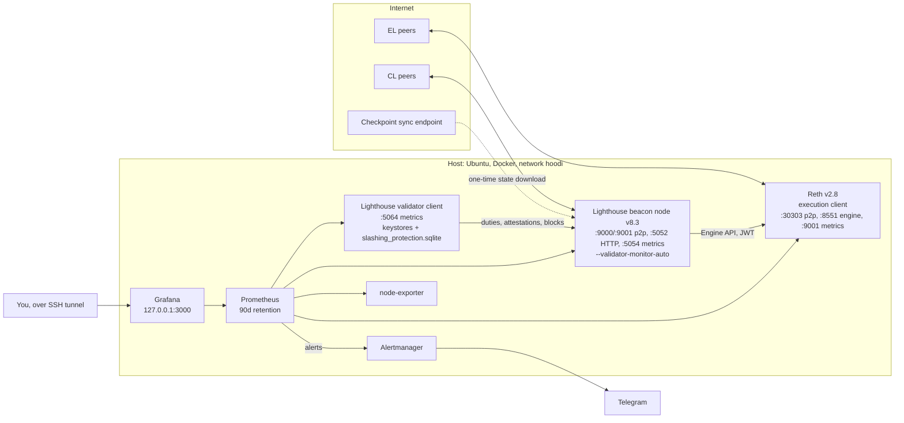

# Architecture

One bare-metal host, seven containers, one Docker network. Only the three p2p ports and a
localhost-bound Grafana are reachable from outside the host.



## Why these choices

| Choice | Reason |
| --- | --- |
| Reth + Lighthouse | Both are minority clients on mainnet, which is where new validators are asked to go. Both are Rust, which matches the rest of the plan. |
| Checkpoint sync | Hoodi is small, but syncing the beacon chain from genesis is still hours of wasted time. The finalized root is verified by hand after the first sync. |
| `--full` on Reth | A full node is enough for a validator. The archive node is a separate project (sepolia-archive). |
| `--validator-monitor-auto` | The beacon node exports per-validator attestation hit and miss counters for every key the VC attaches. That is what the Grafana effectiveness panels read. |
| Doppelganger protection on | Costs two to three epochs of attestations per restart. Prevents the one mistake that burns a validator: running the same keys twice. |
| Separate UIDs per container | Reth, beacon and VC each run as their own unprivileged user, so a bug in one cannot read another's data directory. The VC directory holds the keystores. |
| Grafana on localhost | No public dashboards until there is a reverse proxy with auth. Use an SSH tunnel. |
| Telegram alerts | Free, instant, and already where the operator is. |

## Data layout

```
data/
  reth/                     execution chain data (Storage V2)
  lighthouse-beacon/        beacon chain db, network keys
  lighthouse-validator/
    validators/             imported keystores + validator_definitions.yml
    validators/slashing_protection.sqlite    <- the file the backup script exports
  prometheus/               90 days of metrics
  grafana/                  dashboard edits made in the UI
  alertmanager/             silences and notification log
backups/                    slashing-protection exports, dated; rsync off-host
```
